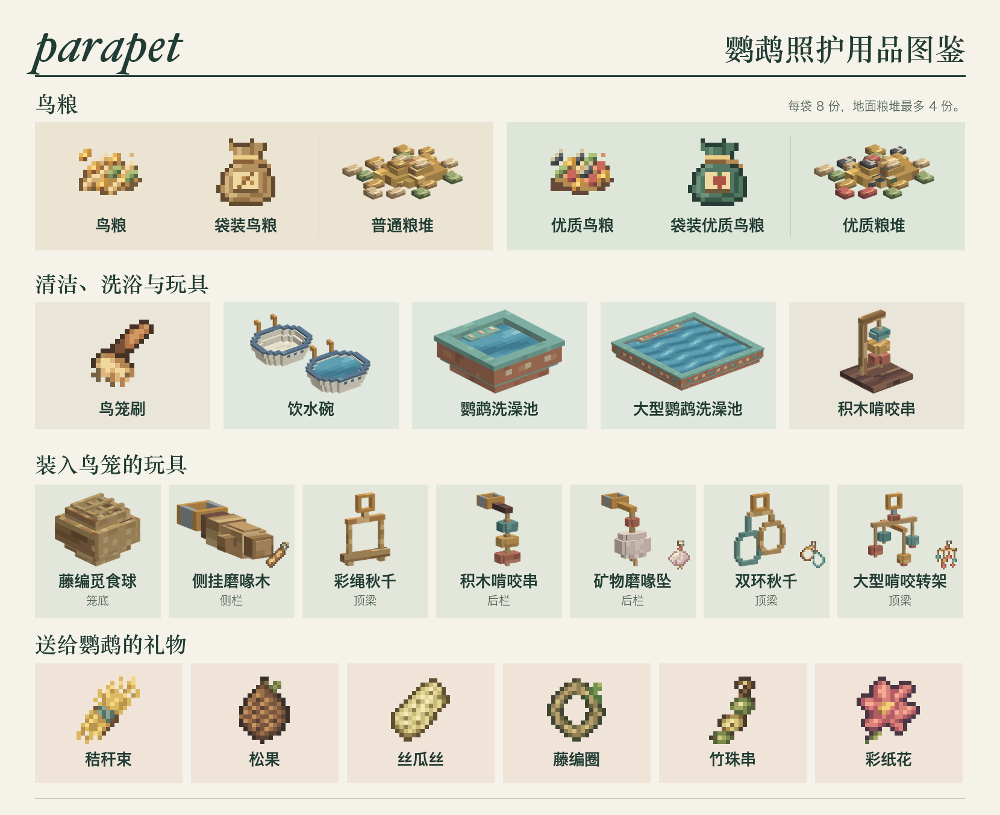
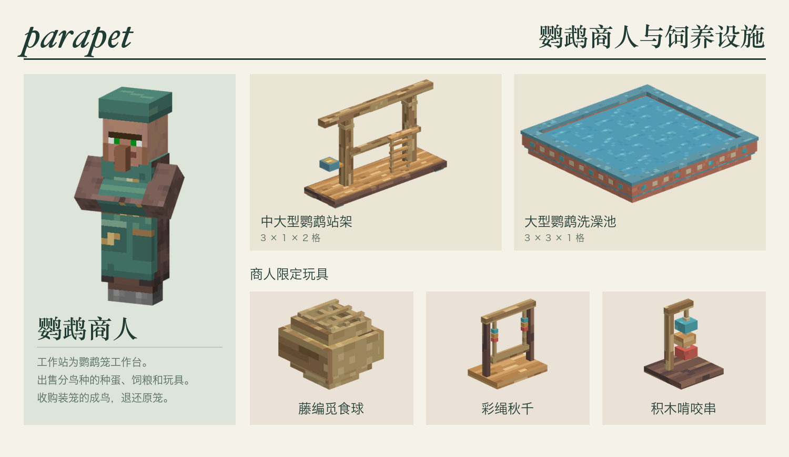
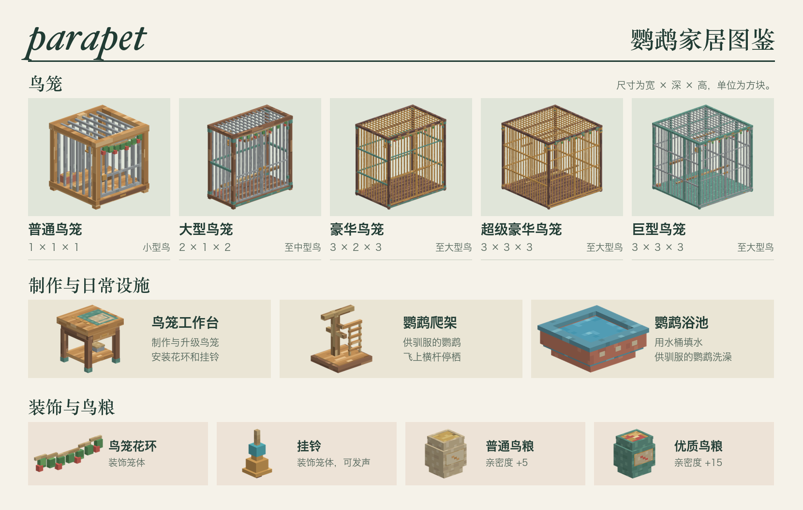
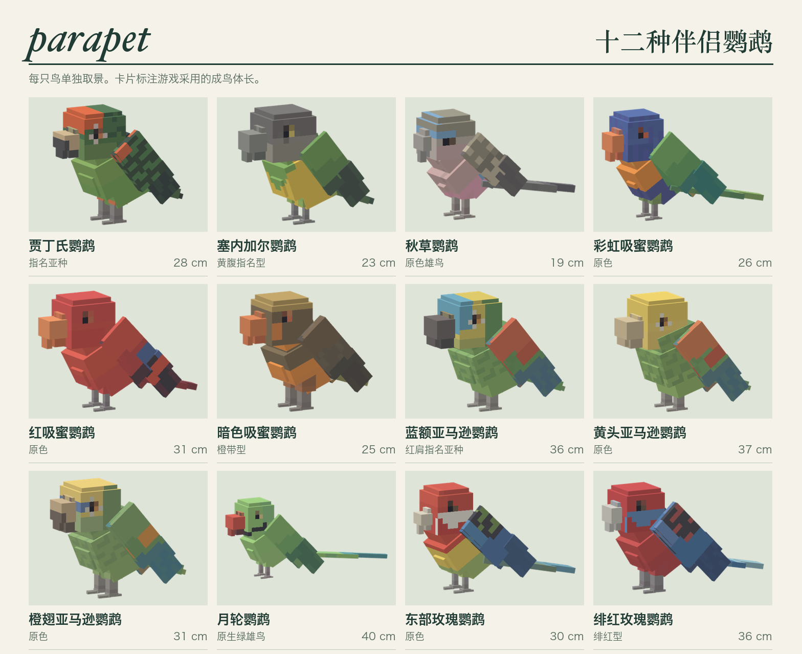
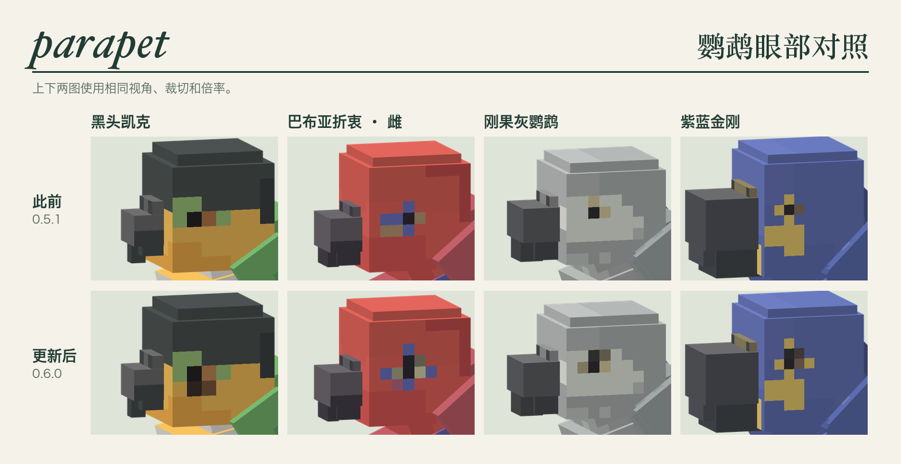
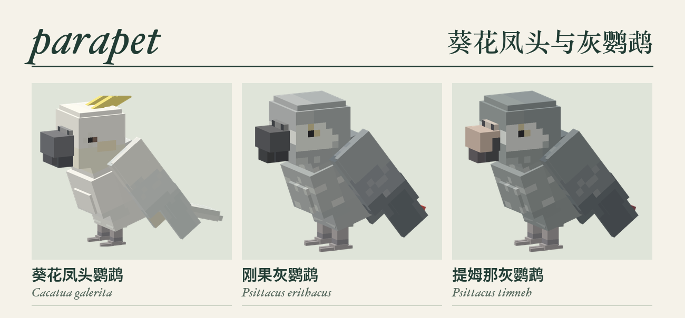
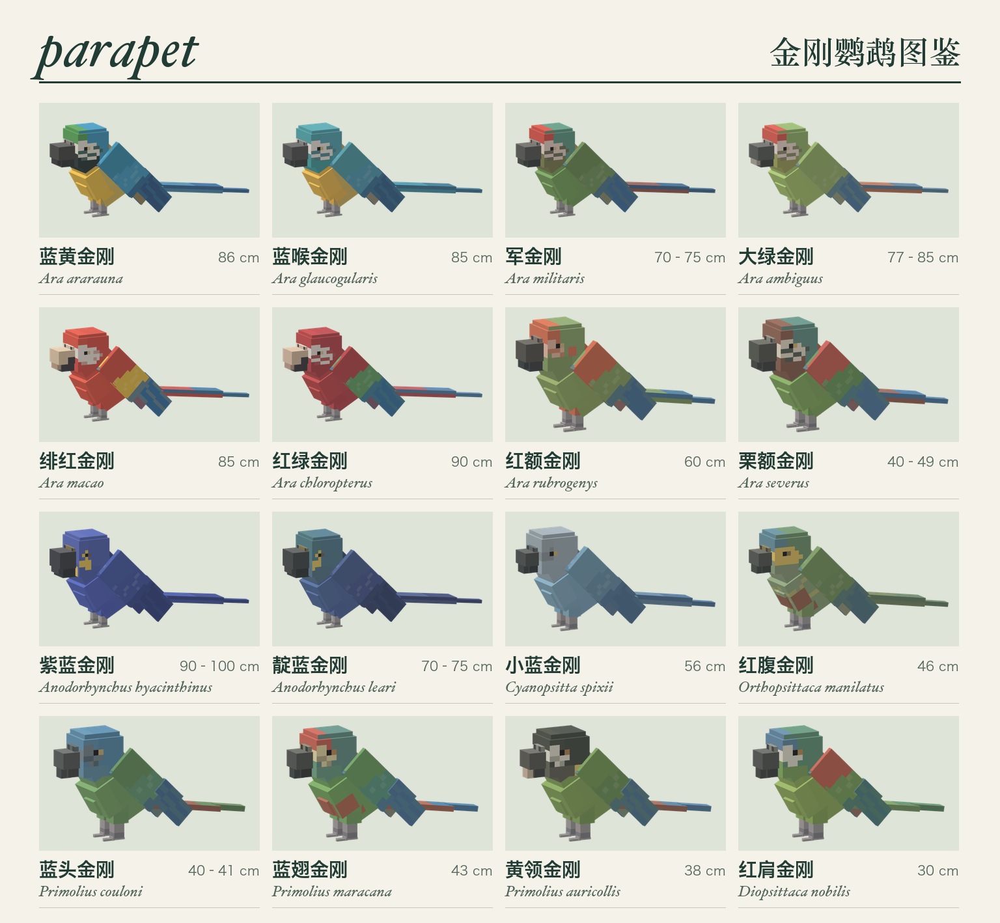
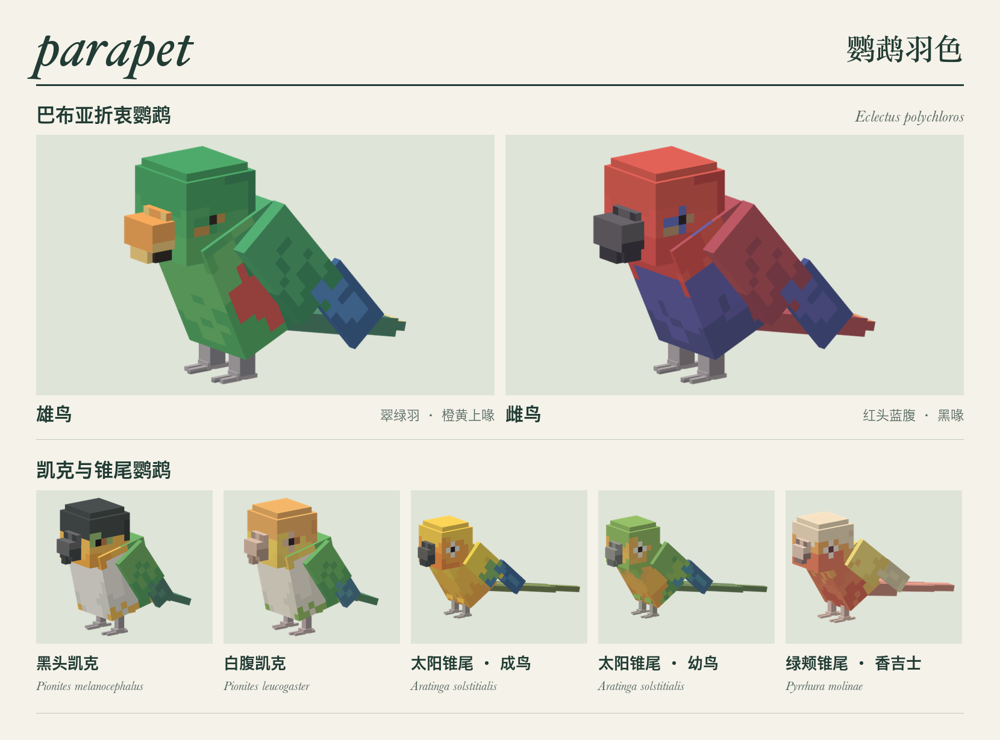

# parapet

Minecraft Java 版 26.3 的 Fabric 宠物鹦鹉模组，收录 38 个独立鸟类实体。可以在野外让喜欢的鸟主动靠近，驯服后一起旅行、繁殖，也可以把它安置在家中的栖木上。

## 0.13.0 肩栖与互动

在中键互动面板选择「上肩」，可让一只自己的中、小型鹦鹉停在肩上。肩上的鹦鹉免受伤害并随主人传送，按住 Shift 再点击中键即可放下。亲密度达到 15 后可呼哨让鹦鹉回应。各鸟种的生命上限按体型和体长分配，为 8 至 80 点。

## 0.12.1 直接入笼

打开任意尺寸的鸟笼，再手持携鸟笼右击笼身，即可将自己的鹦鹉移入笼内。装有 Carry On 时，也可以抱着鹦鹉直接右击。目标笼需要有足够空间。

## 0.12.0 笼内玩具、喂养与清洁



用一张纸和八份同品质鸟粮装一袋，拿在手里就能分八次喂食。也可以把散粮放在地面，一格最多铺四份。路过的野鸟、自由活动的宠物都能凑近啄食。两种鸟粮、粮袋和积木啃咬串换上了新的像素材质与模型。

给普通或大型鸟澡池注水后，可以看到细小水纹沿池面游动。小型鹦鹉低头点水、快速拍翅，中型左右侧身轮流拨水，大型会先压低胸颈，再展开宽翼缓缓击水。[查看三种洗浴动作](art/parrot-bathing.gif)

笼盘上出现谷壳和羽屑时，可用**鸟笼刷**清扫，为自己的笼中鸟增加 5 点亲密度。也可以送它丝瓜丝、松果、秸秆束、藤编圈、竹珠串或彩纸花，每件礼物增加 6 点。刷子和六种礼物均可合成，也会出现在鹦鹉商人的货单中。[饲养操作与配方](docs/cages-and-care.md) · [商人货单](docs/parrot-merchant.md)

鹦鹉饮水碗既能放在地面，也能挂在笼内。两档食槽与饮水碗各有固定位置。五档笼子分别有 1、2、3、4、5 个玩具位。藤编觅食球放在笼底，磨喙木装在侧栏，彩绳秋千、双环秋千和大师商人独售的大型啃咬转架从笼顶悬挂。笼内用品随空间同比缩放。手持粮袋右击鸟笼，每次倒一份。拆下无鸟笼，会退回剩余散粮、碗以及已安装的全部玩具和装饰。

所有 38 种鹦鹉入笼后会同比缩小，出笼恢复原有体型。笼内的鸟只表演专属待机与进食动作，喝水时也会低头再抬喙。动作按鸟种和笼型调整，保留它原有的羽色、冠羽和尾羽比例。[玄凤笼内进食实拍](art/caged-cockatiel-feeding.gif) · [巨型鹦鹉笼玩具布置实拍](art/cage-mounted-toys.png)

## 0.11.0 从晨鸣到夜栖与新版图鉴

清晨去主世界观察一群野生鹦鹉。相互看得见的同类有时会一呼一应，听到鸣声的鸟先侧头，偶尔也会小声回叫。白天，野生虎皮会在草丛边啄食，彩虹吸蜜、红吸蜜和暗色吸蜜会走近小花伸舌取食。夜间，野鸟会寻找安全的树冠，落稳后收起一只脚、把头贴到肩边，天亮再醒来。

0.11.0 引入了理羽、侧耳和打盹。0.12.0 起，笼内会切换到专属待机和进食动作。淋过雨或洗过澡的鸟，在离开水、避开雨并安静落稳后，会抖开翅尾甩出水珠。图鉴左页点击「习性」或按 **H**，可以边看模型边查观察提示。[野外观察与饲养细节](docs/parrot-daily-life.md)

打开鹦鹉图鉴时，书封会沿书脊展开，纸页随后落定。图版保留了更多页边空间，并标明参考成鸟体长。打开物种目录，点击「全部」或按 **F** 可只看待收录的鸟。[图鉴阅读与操作](docs/parrot-field-guide.md)

## 0.10.0 鸟笼制作与安装

在鹦鹉笼工作台用三组材料制作空笼，再逐档升级。三种玩具、花环和挂铃均可在原版工作台单独制作，手持它们右击笼体即可安装。Shift＋右击笼体可放入或取出自己的鹦鹉。生存模式拆下无鸟的笼子时，笼体与里面的每件配件会分别掉落。在 JEI 中可查询五档鸟笼的材料、用量和工作台。[完整配方与操作](docs/cages-and-care.md)

## 0.9.2 创造模式标签页

打开创造模式物品栏，选择以鹦鹉图鉴为图标的「Parapet 鹦鹉」标签页。图鉴和鸟粮放在最前面，其后依次是工作台、五档鸟笼、爬架、洗澡池、玩具和装饰。最后两组是种蛋和刷怪蛋，各自按图鉴中的物种顺序排列。

## 0.9.1 整合包兼容

鹦鹉的飞行、觅食和物种动作数据使用专用资源目录。与 Frog Petting 同时安装时，两套动画加载器可以各自读取对应的文件。

图鉴使用原版的展示实体机制绘制鹦鹉，修复了打开图鉴第一页时可能发生的客户端崩溃。

## 0.9.0 野外观察与宠物互动

一本书、一根羽毛和一份小麦种子可以无序合成**鹦鹉图鉴**。每个玩家有 38 个物种条目。未收录的鸟显示立体黑色剪影，驯服后可以看见彩色模型，并可轮换该物种的羽色。点击页角会看到纸张翻过书脊；目录可直接跳转到任一物种。[图鉴操作](docs/parrot-field-guide.md)

六档稀有度决定适宜栖地中哪些区域可能有鸟，以及它在原版生成表中的权重。群体大小另按该鸟种的结群习性设置：虎皮鹦鹉常见，每群目标 4–8 只；蓝喉金刚极稀有，每群目标 2–3 只。[38 个实体的栖地、成群数量和保护机构资料](docs/parrot-habitats.md)

潜行、空手右击自己的鹦鹉可打开互动面板。打招呼和轻抚随时解锁，随着亲密度提高，还能进行触指训练、伸翼、举爪击掌和转圈。图鉴的纸页、书封、互动面板与按钮图标均为本模组绘制。[动作与解锁条件](docs/parrot-interactions.md) · [界面贴图排版示意](art/field-guide-and-interactions.png)

非洲灰的两款羽色、葵花凤头、雌雄折衷和蓝黄金刚在胸背与覆羽上增加了稀疏的单像素、双像素短纹。[羽毛材质近照](art/feather-grain.png)

## 0.8.0 鹦鹉商人与幼鸟



在村里放一张鹦鹉笼工作台，等一名无职业的成年村民认领。鹦鹉商人会分五级出售种蛋、种子、鸟粮和玩具，38 种鹦鹉都能通过种蛋获得。拿种蛋右击合适的空地，可孵出一只尚待驯服的雏鸟。想卖出自己的成鸟，先在生存模式挖掉它入住的笼子，手持含鸟笼右击商人。按体型可获得 4、8 或 14 颗绿宝石，装饰好的空笼会退回手中。[鹦鹉商人的分级货单和收购价](docs/parrot-merchant.md)

育雏时，亲鸟的性格会影响哪个羽色显现，未显现的颜色可以传给下一代。异色牡丹的幼鸟有机会呈现全部 122 种羽色。正常游戏速度下，亲鸟求偶约 15 秒，成功繁殖后休息 25 分钟，雏鸟自然成长约 100 分钟。雏鸟出生时即可看见它长大后的配色。[羽色遗传、性格权重与成长示例](docs/plumage-inheritance.md)

## 鸟笼与饲养



用木板、铁栏杆和木棍在鹦鹉笼工作台制作第一座笼子。普通笼适合虎皮、牡丹和秋草，大型笼可收容凯克等中型鸟，豪华、超级豪华与巨型笼可以收容全部鸟种。潜行右击笼体可让自己的鸟进出。爬架和洗澡池供宠物自行使用。中大型鸟优先选择 3 × 1 × 2 的中大型爬架、3 × 3 × 1 的大型洗澡池（宽 × 深 × 高）。藤编觅食球、彩绳秋千和积木啃咬串可以摆在旁边，留出空间让鸟落脚玩耍。鸟粮能培养亲密度。[鸟笼尺寸、操作与全部配方](docs/cages-and-care.md)

野鸟会注意到手持合适驯服物的玩家。带小麦种子找虎皮，带可可豆找吸蜜鹦鹉，或带鸟粮吸引任一鸟种。安静站定，等鸟靠近并出现绿色粒子，再右击尝试驯服。[38 种鸟的栖息地、体型与驯服物图鉴](docs/parrot-habitats.md)

## 十二种伴侣鹦鹉



十二种伴侣鹦鹉包括贾丁氏、塞内加尔、秋草、彩虹吸蜜、红吸蜜、暗色吸蜜、蓝额亚马逊、黄头亚马逊、橙翅亚马逊、月轮、东部玫瑰和绯红玫瑰。十二种鸟各有独立实体与刷怪蛋，共有 30 款羽色。秋草和月轮还可选择雌雄，合计 41 种可召唤的羽色与性别组合。[物种、体长、羽色与完整召唤指令](docs/companion-parrots.md)

彩虹、红和暗色吸蜜鹦鹉觅食或繁殖时接受西瓜片或甜浆果，觅食时还会伸舌。葵花凤头、和尚幼鸟、吸蜜鹦鹉和凯克有各自的互动动作。[四种专属动作预览](art/species-actions.gif)



中大型鸟的深瞳稍向下延展。凯克保留暖色虹膜，雌折衷眼周留有蓝羽，刚果灰保留浅虹膜与灰白裸面，紫蓝金刚则保留眼周的黄色裸皮。[凯克眼色](https://parrots.org/encyclopedia/black-headed-parrot/) · [巴布亚折衷眼圈](https://parrots.org/encyclopedia/papuan-eclectus/) · [紫蓝金刚裸皮](https://parrots.org/encyclopedia/hyacinth-macaws/)

## 葵花凤头、非洲灰与金刚鹦鹉



**葵花凤头鹦鹉**（*Cacatua galerita*）有白色体羽、硫黄色冠羽和石板灰色喙。**刚果灰鹦鹉**（*Psittacus erithacus*）为浅灰羽、黑喙、鲜红尾。**提姆那灰鹦鹉**（*Psittacus timneh*）略小，羽色深灰，上喙有浅角色块，尾羽呈暗栗红。两种灰鹦鹉共用游戏实体 `parapet:african_grey` 和刷怪蛋，存档用 `Species` 区分，分别与同种个体繁殖。[葵花凤头物种资料](https://parrots.org/encyclopedia/sulphur-crested-cockatoo/) · [刚果灰鹦鹉资料](https://parrots.org/encyclopedia/grey-parrot/) · [提姆那灰鹦鹉保育资料](https://parrots.org/wp-content/uploads/2022/09/ps_spring_2018.pdf)



**金刚鹦鹉**每种都有自己的实体 ID 和刷怪蛋。红肩金刚约 30 cm，紫蓝金刚在游戏中按 95 cm 建模。辨认相近的鸟种时，可以看喉斑、裸脸上的羽线以及合翅后翼带的颜色。完整名录列出每种鸟的学名、体长、实体 ID 和召唤方式。[金刚鹦鹉物种与指令](docs/macaws.md)

## 其他鸟种与羽色



**巴布亚折衷**取指名亚种 *Eclectus polychloros polychloros*。雄鸟翠绿，橙黄上喙、黑色下喙，展翅可见红色翼衬。雌鸟头和上胸鲜红，下胸和腹部深蓝，喙黑。外观由同一个性别值决定，存档保留性别。雌雄成年鸟可以配对，幼鸟独立随机生成性别。[World Parrot Trust 物种资料](https://parrots.org/encyclopedia/papuan-eclectus/)

**香吉士**是绿颊锥尾的 Suncheek 色型，带浅冠、浅色喙、黄翼和红胸腹。游戏内随机自然生成或使用普通绿颊刷怪蛋时，出现概率为 1/64。繁殖时可继承亲鸟羽色。[育种者的色型记录](https://feathert.com/suncheek.html)

[牡丹与和尚代表色](art/lovebirds-and-monks.png)

[桃脸牡丹 45 色](art/lovebird-peach.png) · [费氏牡丹 51 色](art/lovebird-fischer.png) · [面罩牡丹 26 色](art/lovebird-masked.png) · [和尚鹦鹉 10 色](art/monk-parakeets.png)

牡丹色目按品种、底色和实际可见花纹编目。各地商品名会变化，育种者也会推出新组合。查找黄桃、派特、欧翼、欧帕、白脸、奶油等名称时，可参阅 [牡丹商品名、羽色 ID 与育种资料](docs/lovebird-colors.md)。

[玄凤与绿颊八色图鉴](art/parrot-plumages.png)

[虎皮鹦鹉六色图鉴](art/budgerigars.png) · [虎皮鹦鹉游戏实拍](art/budgerigars-ingame.png)

## 鸟种与体型

各鸟种成鸟按同一尺度建模，以现有虎皮鹦鹉的游戏大小为基准。比例取自收翅站立时的喙尖至尾尖长度。同种的不同羽色共用体型。中大型鸟把腰、胸、肩和前胸龙骨分层建模，折翼上区分翼肩与次级飞羽。转身时能看见胸廓收向腰部，展翼后仍能辨认翼衬。玄凤有独立冠羽和细长尾羽，绿颊的头胸较宽厚。碰撞箱随站姿的宽度和高度设置。[躯干改造前后对照](art/torso-detail.png)

| 鸟种 | 参考成鸟体长 | 相对虎皮体长 |
| --- | ---: | ---: |
| 牡丹鹦鹉 | 约 15 cm | 0.83 倍 |
| 虎皮鹦鹉 | 18 cm | 1.00 倍 |
| 凯克鹦鹉 | 23 cm | 1.28 倍 |
| 绿颊锥尾鹦鹉 | 26 cm | 1.44 倍 |
| 和尚鹦鹉 | 29 cm | 1.61 倍 |
| 太阳锥尾鹦鹉 | 30 cm | 1.67 倍 |
| 玄凤鹦鹉 | 31 cm | 1.72 倍 |
| 刚果灰鹦鹉 | 33 cm | 1.83 倍 |
| 提姆那灰鹦鹉 | 30 cm | 1.67 倍 |
| 巴布亚折衷鹦鹉 | 35 cm | 1.94 倍 |
| 葵花凤头鹦鹉 | 50 cm | 2.78 倍 |
| 16 种金刚鹦鹉 | 游戏采用 30–95 cm | 1.67–5.28 倍 |
| 十二种伴侣鹦鹉 | 秋草 19 cm 至月轮 40 cm | 1.06–2.22 倍 |

野外寻找时，同为金刚鹦鹉也可能需要去截然不同的地方。比如紫蓝金刚可在热带草原寻找，红腹金刚要到沼泽或红树林沼泽的水边。每种鸟的群系和落脚条件列在[栖息地与驯服物图鉴](docs/parrot-habitats.md)。

虎皮取平均体长 18 cm，绿颊取 26 cm，玄凤取 29–33 cm 区间的中值 31 cm。[BirdLife Australia 虎皮鹦鹉资料](https://www.birdlife.org.au/bird-profiles/budgerigar/) · [World Parrot Trust 绿颊锥尾鹦鹉资料](https://parrots.org/encyclopedia/green-cheeked-conure/) · [World Parrot Trust 玄凤鹦鹉资料](https://parrots.org/encyclopedia/cockatiel/)

牡丹采用短尾、厚喙的共同体型，桃脸与费氏参考 15 cm，面罩参考 14.5 cm。和尚参考 29 cm，保留较宽的胸部和长尾。[桃脸](https://parrots.org/encyclopedia/rosy-faced-lovebird/) · [费氏](https://parrots.org/encyclopedia/fischers-lovebird/) · [面罩](https://parrots.org/encyclopedia/masked-lovebird/) · [和尚](https://parrots.org/encyclopedia/monk-parakeet/)

黑头凯克采用 *Pionites melanocephalus*，白腹凯克采用 *Pionites leucogaster*。两者均为短尾、身形结实的凯克，保留各自的头、喙和腿羽配色。太阳锥尾采用 *Aratinga solstitialis* 的金黄头身、绿蓝翼羽。0.8.0 中太阳锥尾从雏鸟起就使用这套配色，幼鸟为成鸟线性尺寸的 65%。[黑头凯克](https://parrots.org/encyclopedia/black-headed-parrot/) · [白腹凯克](https://parrots.org/encyclopedia/white-bellied-parrot/) · [太阳锥尾](https://parrots.org/encyclopedia/sun-conure/)

## 羽色与召唤

| 实体 ID | 物种、羽色或性别 |
| --- | --- |
| `parapet:budgerigar` | 原生绿 `green`、天蓝 `blue`、明黄 `yellow`、雪白 `white`、青绿 `turquoise`、紫罗兰 `violet` |
| `parapet:cockatiel` | 原灰 `gray`、黄化 `lutino`、珍珠 `pearl`、白脸 `whiteface` |
| `parapet:green_cheek_conure` | 原色 `normal`、凤梨 `pineapple`、蓝化 `turquoise`、肉桂 `cinnamon`、香吉士 `suncheek` |
| `parapet:lovebird` | 122 款，羽色 ID 以 `peach_`、`fischer_` 或 `masked_` 开头，完整 ID 见上方三张牡丹图鉴 |
| `parapet:monk_parakeet` | 原绿 `green`、天蓝 `blue`、松石 `turquoise`、黄化 `lutino`、白化 `albino`、肉桂 `cinnamon`、淡色 `pallid`、灰绿 `grey_green`、钴蓝 `cobalt`、紫罗兰 `violet` |
| `parapet:caique` | 黑头凯克 `black_headed`、白腹凯克 `white_bellied` |
| `parapet:eclectus` | 用 `Sex` 指定 `male`（雄绿）或 `female`（雌红蓝） |
| `parapet:sun_conure` | `normal` 金黄色。幼鸟与成鸟同色，幼鸟较小且身边偶有白色羽粉 |
| `parapet:sulfur_crested_cockatoo` | 葵花凤头鹦鹉，原生羽色 |
| `parapet:african_grey` | 用 `Species` 指定刚果 `congo` 或提姆那 `timneh` |
| 12 个伴侣鹦鹉实体 | 秋草与月轮用 `Plumage` 和 `Sex`，其余使用 `Plumage`。[完整实体 ID 与命令](docs/companion-parrots.md) |
| 16 个 `parapet:…_macaw` 实体 | 按物种的完整实体 ID 召唤，每种都有独立的同名刷怪蛋。[完整 ID](docs/macaws.md) |

创造模式中可以按鸟种名称查找刷怪蛋。启用命令后，可按下列示例选择物种或羽色。

```mcfunction
/summon parapet:jardines_parrot ~ ~ ~ {Plumage:"gulielmi"}
/summon parapet:bourkes_parrot ~ ~ ~ {Plumage:"opaline",Sex:"female"}
/summon parapet:dusky_lory ~ ~ ~ {Plumage:"yellow_band"}
/summon parapet:blue_fronted_amazon ~ ~ ~ {Plumage:"xanthopteryx"}
/summon parapet:rose_ringed_parakeet ~ ~ ~ {Plumage:"green",Sex:"male"}
/summon parapet:crimson_rosella ~ ~ ~ {Plumage:"adelaide"}
/summon parapet:african_grey ~ ~ ~ {Species:"congo"}
/summon parapet:african_grey ~ ~ ~ {Species:"timneh"}
/summon parapet:sulfur_crested_cockatoo ~ ~ ~
/summon parapet:blue_and_yellow_macaw ~ ~ ~
/summon parapet:hyacinth_macaw ~ ~ ~
/give @s parapet:red_shouldered_macaw_spawn_egg
/give @s parapet:red_shouldered_macaw_hatching_egg
/summon parapet:eclectus ~ ~ ~ {Sex:"male"}
/summon parapet:eclectus ~ ~ ~ {Sex:"female"}
/summon parapet:green_cheek_conure ~ ~ ~ {Plumage:"suncheek"}
/summon parapet:caique ~ ~ ~ {Plumage:"white_bellied"}
/summon parapet:sun_conure ~ ~ ~ {Age:-120000}
/summon parapet:lovebird ~ ~ ~ {Plumage:"peach_lutino"}
/summon parapet:monk_parakeet ~ ~ ~ {Plumage:"cobalt"}
/summon parapet:cockatiel ~ ~ ~ {Plumage:"pearl"}
/summon parapet:green_cheek_conure ~ ~ ~ {Plumage:"pineapple"}
/summon parapet:budgerigar ~ ~ ~ {Plumage:"violet"}
```

## 安装与饲养

使用 Java 25、Minecraft 26.3 和 Fabric Loader 0.20.1。将 `parapet-0.13.0.jar` 与适配 26.3 的 Fabric API 0.167.0+26.3 放入实例的 `mods` 目录。升级时用新版替换原来的 parapet JAR。多人游戏的客户端和服务端都需要安装。

野鸟进入 3.25 格以内后，手持它偏好的物品或鸟粮，站定约 2 秒，出现绿色粒子后右击。驯服成功会出现爱心。主人站立空手右击鸟可切换停留与跟随，潜行空手右击鸟会打开互动面板，可查看亲密度并选择轻抚等动作。[驯服距离、成功率与饲养操作](docs/cages-and-care.md)

繁殖时，让两只同种、驯服的成年鸟离笼并处于跟随状态。三种吸蜜鹦鹉各喂一份西瓜片或甜浆果，其余鸟种各喂一份小麦、甜菜、西瓜或南瓜种子。幼鸟从双亲中的一方继承主人。折衷、秋草与月轮需要雌雄配对，雏鸟在出生时独立决定性别，使用对应性别的成年配色。

牡丹可以跨桃脸、费氏和面罩组别配对。两只亲鸟显色 ID 不同时，雏鸟从 122 款中等概率抽取显色。同色配对遵循普通遗传，候选突变限于该显色组别。黑头与白腹凯克各自配对，刚果灰与提姆那灰各自配对，16 种金刚分别与同种配对。[牡丹外观与育种示例](docs/lovebird-colors.md)

## 行为与动作

| 情境 | 鸟的表现 |
| --- | --- |
| 放松站立 | 轻轻起伏、转头和摆尾，有时扭头梳理翼羽。个体的待机节奏错开。 |
| 觅食 | 将一份对应食物丢在平静、落地的鸟附近。它会走近取食，每次消耗一份，受伤时恢复 1 点生命。停留命令、跟随主人与繁殖优先。地面觅食需要开启 mob griefing。 |
| 跟随主人 | 主人空手右键切换到跟随。鸟在地面随移动速度交替迈步，离地后按前进与爬升速度衔接拍翼和滑翔。 |
| 飞行 | 起飞时展开双翼，悬停和爬升时拍翼，向前飞行时穿插滑翔。转弯时身体侧倾，落地后逐渐收翅。 |
| 主人归来 | 主人曾离开超过 8 格或离线，再靠近到 3 格以内时，平静、落地且能看见主人的宠物会转身短叫、点头招呼。持续站在身边时只招呼一次。 |
| 主人抚摸 | 主人蹲下、空手右键平静落地的鸟。它会歪头、点头、轻展双翼并冒爱心，保留原先的跟随或停留指令。 |

葵花凤头看到玩家走近到 3 格以内、附近玩家亮出种子，或迎接主人时会展示黄色头冠。已驯服的和尚幼鸟在 3 格内看见主人手里的种子时，会点头振翅乞食。彩虹、红和暗色吸蜜鹦鹉在地面吃水果时伸舌。凯克在迎接主人或接受抚摸时会嬉跳。

每档都有独立编排的待机、觅食、理羽、迎接、拍翼与滑翔六段关键帧。动画同时考虑体长和体态。两种非洲灰使用中型步态与拍翼，葵花凤头使用大型动作。金刚的五套骨架中，迷你型使用中型动作，其余四套使用大型动作。巴布亚折衷约 35 cm、450–600 g，也使用大型动画。[折衷体型资料](https://parrots.org/encyclopedia/papuan-eclectus/)

| 动画档位 | 鸟种 | 可见动作 |
| --- | --- | --- |
| 小型 | 虎皮、牡丹、秋草 | 快速转头、短拍翼、小步行走 |
| 中型 | 凯克、绿颊、和尚、太阳锥尾、玄凤、两种非洲灰、贾丁氏、塞内加尔、三种吸蜜、月轮、两种玫瑰，以及蓝头、蓝翅、黄领、红肩金刚 | 左右探啄、蹬腿弹步迎接、张翼制动 |
| 大型 | 巴布亚折衷（雌雄共用）、葵花凤头、三种亚马逊与其余 12 种金刚 | 缓慢移重心、深点头、长行程拍翼和更长的滑翔 |

[中型与大型动作对照](art/medium-large-motions.gif) · [初版动作编排](art/parrot-motions.gif)

## 源码与模型

在项目根目录使用 JDK 25 运行 `./gradlew assemble`，Windows 使用 `gradlew.bat assemble`。可安装的 JAR 位于 `build/libs/`。开发环境可运行 `./gradlew runClient`。

鸟笼、工作台、普通与中大型设施、玩具、配饰和鸟粮均可在 Blockbench 中编辑。[家具与用品工程](art/furniture)

在 Blockbench 中打开任一鸟种工程，点击纹理面板的配色即可切换。工程内嵌原创羽色图集，按每个模型单位一格纹素绘制，保留原版的 16px 观感。

每个工程的「动画」页都内嵌待机、觅食、理羽、抚摸回应、拍翼和滑翔六段可编辑关键帧。游戏按体型读取[小型](src/client/resources/assets/parapet/parrot_clips/pet_parrots.json)、[中型](src/client/resources/assets/parapet/parrot_clips/medium_parrots.json)或[大型](src/client/resources/assets/parapet/parrot_clips/large_parrots.json)动作数据，并叠加步态、注视和转向。[物种专属动作](src/client/resources/assets/parapet/parrot_clips/species_actions.json)包括葵花凤头展冠、和尚幼鸟乞食、吸蜜鹦鹉探舌取食和凯克嬉跳。

十二种伴侣鹦鹉各有单独的工程，图鉴中的鸟种条目可直接打开对应 `.bbmodel`。[十二种鸟的模型与羽色](docs/companion-parrots.md)

[葵花凤头模型](art/sulfur_crested_cockatoo.bbmodel) · [非洲灰模型](art/african_grey.bbmodel)

金刚鹦鹉按体型共用五套 Blockbench 工程，每套内含对应物种的贴图。[大型长尾](art/macaw_ara.bbmodel) · [较短尾型](art/macaw_short_ara.bbmodel) · [重喙型](art/macaw_heavy.bbmodel) · [纤细型](art/macaw_slender.bbmodel) · [迷你型](art/macaw_mini.bbmodel)

[凯克模型](art/caique.bbmodel) · [折衷模型](art/eclectus.bbmodel) · [太阳锥尾模型](art/sun_conure.bbmodel) · [牡丹模型](art/lovebird.bbmodel) · [和尚模型](art/monk_parakeet.bbmodel) · [虎皮模型](art/budgerigar.bbmodel) · [玄凤模型](art/cockatiel.bbmodel) · [绿颊模型](art/green_cheek_conure.bbmodel)

[公共端源码](src/main/java/dev/parapet) · [客户端模型与渲染源码](src/client/java/dev/parapet/client) · [各物种羽色贴图](src/main/resources/assets/parapet/textures/entity)
