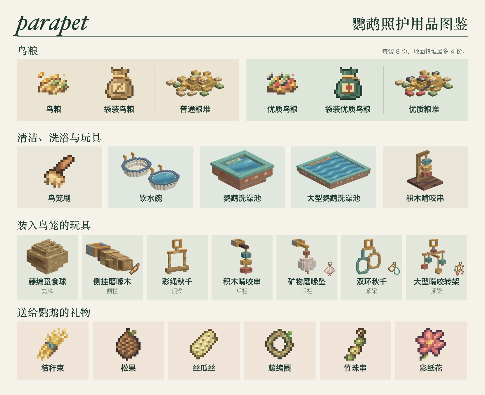
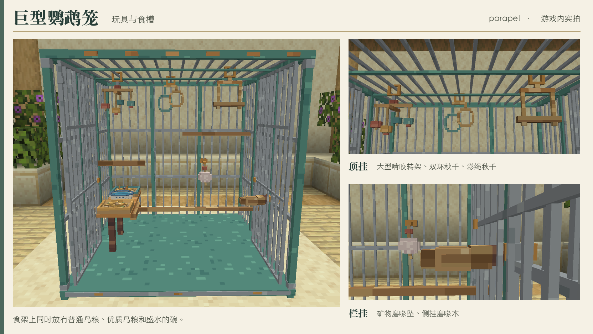

# 从野外相遇到安置入笼

第一次找虎皮鹦鹉，可以带上小麦种子去热带草原。看到鸟后放慢脚步，举着种子停下来，等它自己走近。驯服后让它跟到家，做一个普通鹦鹉笼就能安置。凯克需要大型笼，紫蓝金刚需要豪华笼或更大。各物种出没的群系、驯服物和体型档位见[栖息地与驯服物图鉴](parrot-habitats.md)。

## 接近和驯服野鸟

| 手持物品 | 能吸引的鸟 | 最远吸引距离 | 接受一次驯服尝试后的成功率 |
| --- | --- | ---: | ---: |
| 该物种偏好的原版物品 | 对应鸟种 | 6 格 | 1/3 |
| 鸟粮 | 所有模组鹦鹉 | 10 格 | 2/3 |
| 优质鸟粮 | 所有模组鹦鹉 | 14 格 | 9/10 |

1. 将驯服物拿在主手或副手，进入鸟的视野。虎皮接受小麦种子或甜菜种子，三种吸蜜鹦鹉都接受可可豆。找稀有鸟时也可以直接带优质鸟粮。
2. 保持视线畅通，在吸引距离内停下，让鸟接近。距离约 3.25 格以内时，连续站定 2 秒（40 个游戏刻）。鸟会短叫，头顶出现绿色粒子。
3. 用驯服物右击鸟。每次有效尝试在生存模式下消耗一份，出现爱心表示成功。失败后可以继续尝试。材料不合适或鸟尚未准备好时，提示会告诉你原因，手中的材料会保留。
4. 在 6 格内冲向野鸟容易把它惊飞。放慢脚步或潜行靠近，再站定等它回来。受惊后约 5 秒才能重新建立信任。

## 随身粮袋与地面散粮

在原版工作台的九格里摆入一张纸和八份同品质鸟粮，即可装成一袋。主人手持粮袋右击宠物，每次喂一份，普通粮增加 5 点亲密度，优质粮增加 15 点。野鸟也会被袋中的粮吸引，接近条件、距离和驯服概率与对应散粮相同。物品栏中的容量条和悬停提示显示余量。生存模式用完第八份会收回一张纸。

手持散粮右击有支撑的地面，放下一份。同一位置可以续加同品质散粮，总计最多四份。野鸟和自由活动的宠物会走到粮堆附近啄食，每餐取走一份，受伤时恢复 1 点生命。最后一份吃完，地面露出来。挖掉粮堆会掉出实际剩余的散粮。地面觅食遵循世界的生物破坏规则。

## 五档鸟笼

尺寸按面对门时的**宽 × 深 × 高**计算，单位为方块。面向南北或东西放置会旋转占地。每个笼子都有一个可分配的栖位。

| 笼子 | 宽 × 深 × 高 | 可以入住的鸟 | 实体举例 |
| --- | ---: | --- | --- |
| 鹦鹉笼 | 1 × 1 × 1 | 小型 | 虎皮、牡丹、秋草 |
| 大型鹦鹉笼 | 2 × 1 × 2 | 小型、中型 | 凯克、玄凤、非洲灰、红肩金刚 |
| 豪华鹦鹉笼 | 3 × 2 × 3 | 全部体型 | 折衷、葵花凤头、亚马逊、紫蓝金刚 |
| 超级豪华鹦鹉笼 | 3 × 3 × 3 | 全部体型 | 包括全部 16 种金刚 |
| 巨型鹦鹉笼 | 3 × 3 × 3 | 全部体型 | 包括全部 16 种金刚 |

**放置与进出。** 清空整座笼子的占地和上方空间，站在预定的门前放置。正面朝向放置者，空手右击任一有栏杆或框架的笼体部位可开关门。

1. 把自己已驯服且未拴绳的鹦鹉带到门前 5 格内，保持鸟、门和主人之间视线畅通。
2. 按住 Shift（潜行）右击笼体的任意部位。空笼会接入最近且体型合适的一只鸟，手里可以拿着物品。
3. 再次 Shift＋右击可将自己的鸟领出。笼门开着或关着都能操作，门前要留出能容纳鸟正常体型的空间。离笼后，鸟会恢复原有体型和跟随或停留指令。

## 玩具位与安装位置

站直，手持玩具右击笼体任一部件即可安装，每款限一件。大一档的笼子也能安装小一档的全部款式。挂铃、花环、饮水碗和两种鸟粮各有专位，另行计数。

| 笼型 | 玩具位 | 从这一档起可安装 |
| --- | ---: | --- |
| 普通 | 1 | 藤编觅食球、侧挂磨喙木 |
| 大型 | 2 | 彩绳秋千、积木啃咬串 |
| 豪华 | 3 | 矿物磨喙坠 |
| 超级豪华 | 4 | 双环秋千 |
| 巨型 | 5 | 大型啃咬转架 |

藤球放在笼底，磨喙木固定在侧栏并向笼内伸出。积木啃咬串和矿物磨喙坠夹在后栏，从栖杆边就能看到。彩绳秋千、双环秋千和大型啃咬转架扣在笼顶的横杆上，座杆、吊环和可啃咬的木块都垂在笼内。查看笼子物品说明可查容量和适配玩具。拿剪刀站直右击，一次收回一件，通常从最后安装的玩具开始。有鸟入住时，只有鸟主能安装玩具或用剪刀取下玩具。

旧存档里已经装好的玩具可以保留，超过新容量时须先取下玩具才能补装。剪刀会优先取下当前笼型不再支持的款式。生存模式挖下空笼后，会分别掉落笼体与其中全部用品。

## 笼内布置与饮水

手持饮水碗、玩具或散粮，站直右击笼体任一部件即可安装或添粮。两种鸟粮各有自己的食槽，每槽最多四份。拿普通或优质粮袋也可以添一份，对应的余量会从袋中扣除。饮水碗每笼可装一只，用水桶注水、空桶取水。饮用后水仍保留。还可以把碗直接放在地上供自由活动的宠物饮用。笼鸟入住约 30 秒首次尝试喝水，约 60 秒首次尝试吃粮，之后两项分别每分钟尝试一次。每餐优先取一份普通鸟粮，只有优质粮时会取一份优质粮。鸟受伤时一餐可恢复 1 点生命。

栖杆正前方是水碗，两边分别是普通和优质鸟粮。碗、粮和玩具各有固定位置，模型随笼型同比缩小。栖木上的鸟约每隔 12 至 30 秒会拨响已安装的串珠挂铃。生存模式挖下无鸟鸟笼的任一部件，可取回笼体、碗、两种散粮的剩余份数和所有装饰玩具。拆下的水碗保留当时的水位。

鹦鹉入笼后按比例缩小，沿用自己的羽色和雏鸟比例。笼内仅表现专属待机和进食动作。普通粮和优质粮的啄食方向不同，饮水时会抬喙吞咽。空手开门时鸟仍在原处，潜行右击将它领出后，就会恢复原体型与笼外动作。

## 带鸟搬家与出售成鸟

1. 让自己的鸟坐上栖木。生存模式下，主人用能正常掉落笼体的工具挖掉整座笼子的任意部件，并拾取掉落的**含鸟笼**。五档笼都能使用。物品说明显示鸟名、成年或幼年以及已安装的配件。
2. 在新位置留足笼体和门前空间，用含鸟笼放置整座笼子。鸟会回到栖木上，保留原来的主人、名字、年龄、性格、羽色与携带色、亲密度和健康状态。物品携带期间成长和繁殖冷却暂停。想让鸟留在原地，先用 Shift＋右击领出，再挖空笼。
3. 想出售成鸟时，手持含鸟笼右击一名空闲的鹦鹉商人。小、中、大型成鸟分别卖 4、8、14 颗绿宝石，退回的空笼仍带原有装饰。商人会核对主人和年龄。手持空笼右击则打开普通交易界面。[鹦鹉商人、种蛋和收购规则](parrot-merchant.md)

## 爬架、洗澡池、玩具与亲密度

| 想做的事 | 操作与效果 |
| --- | --- |
| 让鸟上爬架 | 将鹦鹉爬架放在空地，给鸟和折翼上方留出空间。离笼、未拴绳且处于跟随状态的驯服鸟，会在平静时自行飞上横杆，停留约 9 至 14 秒。 |
| 让鸟洗澡 | 用水桶右击鹦鹉洗澡池注水，用空桶可把水取回。有水时池面会泛起细纹。宠物落稳后洗澡约 3.6 秒，小型鸟低头快拍，中型鸟侧身拨水，大型鸟展翼慢压。洗澡后池水仍保留。 |
| 选择设施尺寸 | 中大型爬架宽 3、深 1、高 2 格，大型洗澡池宽 3、深 3、高 1 格。相应普通和大型设施都可用时，中大型鸟优先使用较大的，小型鸟优先使用普通款。 |
| 给鸟玩具 | 把藤编觅食球、彩绳秋千或积木啃咬串放在爬架旁。给鸟留一块能站稳的地面，并留出侧面接近和转身的空间。宠物会啄球、拨动秋千或啃木串，小型鸟还能落在秋千横杆上。玩具可以在原版工作台制作，也可以向鹦鹉商人购买。 |
| 帮鸟找到设施 | 把爬架、洗澡池或玩具放在鸟附近约 6 格的范围内。主人在场时，站在离设施 5 格以内。鸟在停留、笼内栖息、受惊或繁殖时会优先保持原有行为。 |
| 增加亲密度 | 主人用鸟粮右击自己的宠物，每份增加 5 点。优质鸟粮每份增加 15 点。上限为 100 点，到达上限后会提示并保留手里的鸟粮。 |
| 查看亲密度 | 主人潜行、空手右击**鸟**可打开互动面板，查看名字、性格、羽色和亲密度。若它携带另一种羽色，面板也会显示该羽色。宠物平静落地后可选择轻抚或其他已解锁动作。站直空手右击鸟则切换跟随和停留。 |

## 送礼与刷洗笼盘

- 手持丝瓜丝、松果、秸秆束、藤编圈、竹珠串或彩纸花，右击自己的鹦鹉即可送礼。鸟住在笼里时，也可以站直右击任一笼体部件递入礼物。每件增加 6 点亲密度，达到 100 后礼物会留在手里。
- 鸟在笼里累计栖息约两分钟，笼盘上就会积下可见的羽屑和谷壳。拿鸟笼刷站直右击笼体，羽屑消失，并给自己已入住的鹦鹉增加 5 点亲密度。干净的笼盘会提示无需清扫。搬动鸟笼、存档或向商人出售成鸟时，原笼盘的清洁进度也会保留。鸟离笼后还可以清理原来的脏笼盘。
- 生存模式中，一把鸟笼刷可完成 64 次清扫。刷子和六款礼物都能在原版工作台制作，也可以向鹦鹉商人购买。[商人的分级货单](parrot-merchant.md)

## 配对和育雏

让两只可以配对的驯服成鸟离笼、取消停留，再先后喂一份对应食物。彩虹、红和暗色吸蜜鹦鹉吃西瓜片或甜浆果，其他鸟吃小麦种子、甜菜种子、西瓜种子或南瓜种子。秋草、月轮和折衷要一雌一雄。黑头凯克与白腹凯克分别在自己的类群中配对，非洲灰的刚果、提姆那两种也各自配对。金刚要选同一物种。

让亲鸟彼此可见，留出能靠近的空间，求偶约 15 秒后产下一只雏鸟。在正常游戏速度下，雏鸟约 100 分钟成年，亲鸟约 25 分钟后能再繁殖。雏鸟从出生就显示自己羽色和性别对应的成鸟外观，身边偶尔有白色羽粉。中型雏鸟大小为成鸟的 65%，大型为 50%，小型与成鸟等大。放在世界中的雏鸟可以通过喂食加快成长。

可变色亲鸟各传出一个颜色，个体性格影响哪一个显现，另一个可以传给后代。若尚有可选新色，普通配对有 1/16 概率变出双亲都未携带的颜色。牡丹显色 ID 不同时可以跨桃脸、费氏和面罩配对，子代均匀抽取 122 种显色，另从亲鸟继承一个携带色。[性格、携带色与遗传概率](plumage-inheritance.md)

## 原版工作台配方

有序配方从上到下读，斜杠隔开各行，`·` 表示空格。原木、木板和木质台阶分别接受对应标签中的木材。

| 产物 | 三行摆法 | 材料 |
| --- | --- | --- |
| 鹦鹉笼工作台 ×1 | `·铁· / 板台板 / 板·板` | 铁锭 ×1、木板 ×4、原版工作台 ×1 |
| 串珠挂铃 ×1 | `·线· / 金金金 / ·粒·` | 线 ×1、金粒 ×3、铁粒 ×1 |
| 鹦鹉爬架 ×1 | `棍棍棍 / ·棍· / 阶阶阶` | 木棍 ×4、木质台阶 ×3 |
| 鹦鹉饮水碗 ×1 | `砖·砖 / ·砖·` | 红砖物品 ×3 |
| 鹦鹉洗澡池 ×1 | `砖·砖 / 砖砖砖` | 红砖物品（`minecraft:brick`）×5 |
| 中大型鹦鹉爬架 ×1 | `木木木 / 线架线 / 板板板` | 任意原木（`#minecraft:logs`）×3、线 ×2、普通鹦鹉爬架 ×1、木板 ×3 |
| 大型鹦鹉洗澡池 ×1 | `砖·砖 / 砖池砖 / 陶陶陶` | 红砖物品 ×4、普通鹦鹉洗澡池 ×1、原色陶瓦（`minecraft:terracotta`）×3 |

| 无序配方产物 | 材料 |
| --- | --- |
| 藤编觅食球 ×1 | 线、小麦、小麦种子各 ×1 |
| 彩绳秋千 ×1 | 线 ×2、木棍 ×1、任意木质台阶 ×1 |
| 积木啃咬串 ×1 | 线、任意木板、红色染料、黄色染料各 ×1 |
| 侧挂磨喙木 ×1 | 任意原木、木棍、线各 ×1 |
| 矿物磨喙坠 ×1 | 方解石、线、竹珠串各 ×1 |
| 双环秋千 ×1 | 藤编圈 ×2、线与木棍各 ×1 |
| 枝叶花环 ×1 | 线、任意树叶、任意花各 ×1 |
| 鸟粮 ×4 | 小麦种子、南瓜种子、西瓜种子 |
| 优质鸟粮 ×2 | 鸟粮、甜浆果、苹果 |
| 袋装鸟粮 / 袋装优质鸟粮 ×1 | 纸 ×1、相应品质散粮 ×8 |
| 秸秆束 ×2 | 小麦 ×1 |
| 鸟笼刷 ×1 | 秸秆束、线、木棍各 ×1 |
| 丝瓜丝 ×2 | 藤蔓、西瓜片、线各 ×1 |
| 松果 ×2 | 云杉树苗、云杉树叶各 ×1 |
| 藤编圈 ×1 | 藤蔓 ×2、木棍 ×1 |
| 竹珠串 ×1 | 竹子 ×2、线 ×1 |
| 彩纸花 ×2 | 纸 ×2、粉红色染料 ×1 |

大型啃咬转架由大师级鹦鹉商人出售，基础价 16 颗绿宝石。

## 鹦鹉笼工作台配方

放置并右击鹦鹉笼工作台。从左到右放入三组材料，取出一只空笼。可用界面箭头翻看五档配方。安装 JEI 后，可在物品列表对鸟笼按 R 查看配方，对工作台或材料按 U 查看用途（默认键位）。

| 产物 | 第一格 | 第二格 | 第三格 |
| --- | --- | --- | --- |
| 鹦鹉笼 | 任意木板 ×4 | 铁栏杆 ×6 | 木棍 ×2 |
| 大型鹦鹉笼 | 鹦鹉笼 ×1 | 铁栏杆 ×8 | 铜锭 ×2 |
| 豪华鹦鹉笼 | 大型鹦鹉笼 ×1 | 铁栏杆 ×12 | 金锭 ×2 |
| 超级豪华鹦鹉笼 | 豪华鹦鹉笼 ×1 | 铁栏杆 ×16 | 金锭 ×4 |
| 巨型鹦鹉笼 | 超级豪华鹦鹉笼 ×1 | 铁栏杆 ×24 | 铁锭 ×8 |

升级需要一只没有鸟、也没有配件的空笼。已装配的笼子可以先放到地上，领出鹦鹉，再拆笼回收材料。升级完成后可重新安装这些配件。
