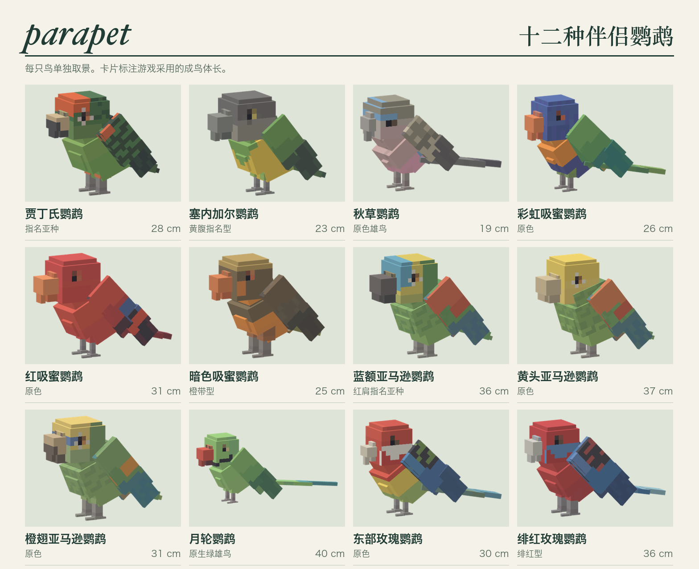

# 十二种伴侣鹦鹉

本图鉴收录十二个独立实体。每个物种都有创造模式刷怪蛋，也有鹦鹉商人出售的生存种蛋。手持种蛋右击合适的空地，即可孵出该物种的未驯服雏鸟。两种非洲长翼鹦鹉、秋草、三种吸蜜、三种亚马逊、月轮和两种玫瑰共收录 30 款羽色。秋草和月轮还可分别指定雌雄，合计 41 种可召唤的羽色与性别组合。

## 选驯服物与鸟笼

体长列为游戏建模选用的成鸟喙尖至尾尖参考值。看体型档可选鸟笼，小型从普通笼起，中型从大型笼起，大型从豪华笼起。寻找野鸟时，按鸟种查对应群系与地形条件。[栖息地与驯服物图鉴](parrot-habitats.md) · [五档鸟笼与驯服操作](cages-and-care.md)

| 鸟种 | 建模体长 | 体型档 | 野外驯服物（可任选其一） |
| --- | ---: | --- | --- |
| 贾丁氏鹦鹉 | 28 cm | 中型 | 南瓜种子、甜菜种子 |
| 塞内加尔鹦鹉 | 23 cm | 中型 | 小麦种子、南瓜种子 |
| 秋草鹦鹉 | 19 cm | 小型 | 小麦种子、甜菜种子 |
| 彩虹吸蜜鹦鹉 | 26 cm | 中型 | 可可豆 |
| 红吸蜜鹦鹉 | 31 cm | 中型 | 可可豆 |
| 暗色吸蜜鹦鹉 | 25 cm | 中型 | 可可豆 |
| 蓝额亚马逊鹦鹉 | 36 cm | 大型 | 南瓜种子、甜菜种子 |
| 黄头亚马逊鹦鹉 | 37 cm | 大型 | 南瓜种子、可可豆 |
| 橙翅亚马逊鹦鹉 | 31 cm | 大型 | 西瓜种子、南瓜种子 |
| 月轮鹦鹉 | 40 cm | 中型 | 小麦种子、西瓜种子 |
| 东部玫瑰鹦鹉 | 30 cm | 中型 | 小麦种子、甜菜种子 |
| 绯红玫瑰鹦鹉 | 36 cm | 中型 | 甜菜种子、西瓜种子 |

鸟粮和优质鸟粮也能驯服表中所有鸟。三种吸蜜鹦鹉的野外驯服物是可可豆，日常觅食和繁殖用西瓜片或甜浆果。其余九种在觅食与繁殖时均接受小麦、甜菜、西瓜或南瓜种子。现实中的吸蜜鹦鹉会用刷状舌采集花蜜及花粉，模组在它们啄食水果时表现伸舌动作。[彩虹吸蜜鹦鹉的野外食性](https://parrots.org/encyclopedia/rainbow-lorikeet/)

使用创造模式物品栏可按中文鸟名搜索刷怪蛋。每个实体 ID 加上 `_spawn_egg` 即为对应物品，例如 `/give @s parapet:rainbow_lorikeet_spawn_egg`。

## 按羽色和性别召唤

以下指令在启用命令的世界中召唤一只成鸟。`Plumage` 选择羽色，秋草和月轮用独立的 `Sex` 字段指定雌雄。秋草和月轮均需两只同种、异性的驯服成鸟配对。雏鸟在出生时独立决定性别，从一开始就显示相应性别与羽色的成鸟贴图。原绿雄月轮的雏鸟已经看得见黑色喉线和粉色后颈圈。部分淡色月轮的雌雄外观相近，可查询 `Sex` 判断。

可变色鸟分别从双亲各获得一个羽色，亲鸟的性格影响其中哪个显现。另一个存为携带色，能传给下一代。若还有不同于双亲全部羽色的新色，普通配对会有 1/16 概率显现新色。正常速度下求偶约 15 秒，亲鸟约 25 分钟后可再繁殖，雏鸟约 100 分钟成年。[羽色遗传与育雏](plumage-inheritance.md) · [商人种蛋价格](parrot-merchant.md)

### 贾丁氏鹦鹉

*Poicephalus gulielmi*。这只短尾非洲鹦鹉背部有深色鳞纹。指名亚种的橙红色从额部延伸到前头顶，翼肩和腿上也有红斑。西非型的额斑更橙，东非型的红额范围较窄。 [贾丁氏鹦鹉 Blockbench 模型](../art/companions/jardines_parrot.bbmodel) · [World Parrot Trust 的贾丁氏鹦鹉条目](https://parrots.org/encyclopedia/red-fronted-parrot/)

| 羽色 | 召唤指令 |
| --- | --- |
| 指名亚种 | `/summon parapet:jardines_parrot ~ ~ ~ {Plumage:"gulielmi"}` |
| 西非型 | `/summon parapet:jardines_parrot ~ ~ ~ {Plumage:"fantiensis"}` |
| 东非型 | `/summon parapet:jardines_parrot ~ ~ ~ {Plumage:"massaicus"}` |

### 塞内加尔鹦鹉

*Poicephalus senegalus*。灰头和 V 字形绿胸在三款中都很醒目。游戏按传统地域描述收录黄腹、橙腹和偏橙红腹三种外观。关于橙腹型 mesotypus 的亚种地位，各名录的处理有差异。 [塞内加尔鹦鹉 Blockbench 模型](../art/companions/senegal_parrot.bbmodel) · [World Parrot Trust 的塞内加尔鹦鹉条目](https://parrots.org/encyclopedia/senegal-parrot/) · [西非鸟类志的三型描述](https://horizon.documentation.ird.fr/exl-doc/pleins_textes/divers17-09/43696.pdf)

| 羽色 | 召唤指令 |
| --- | --- |
| 指名型 · 黄腹 | `/summon parapet:senegal_parrot ~ ~ ~ {Plumage:"senegalus"}` |
| 橙腹型 | `/summon parapet:senegal_parrot ~ ~ ~ {Plumage:"mesotypus"}` |
| 橙红腹型 | `/summon parapet:senegal_parrot ~ ~ ~ {Plumage:"versteri"}` |

### 秋草鹦鹉

*Neopsephotus bourkii*。原色为灰褐背、玫粉腹，成年雄鸟额前有蓝带，雌鸟的额部较淡。欧帕色扩大粉色羽区；黄化为浅黄底配粉腹；红宝石是欧帕与黄化的组合，粉红面积更大。游戏为每种羽色保留雌雄外观。 [秋草鹦鹉 Blockbench 模型](../art/companions/bourkes_parrot.bbmodel) · [World Parrot Trust 的秋草条目](https://parrots.org/encyclopedia/bourkes-parrot/) · [Eddie’s Aviary 的原色与变异繁育记录](https://www.eddiesaviary.com/bourkes/mutations)

| 羽色 | 成年雄鸟 | 成年雌鸟 |
| --- | --- | --- |
| 原色 | `/summon parapet:bourkes_parrot ~ ~ ~ {Plumage:"wild",Sex:"male"}` | `/summon parapet:bourkes_parrot ~ ~ ~ {Plumage:"wild",Sex:"female"}` |
| 欧帕／玫粉 | `/summon parapet:bourkes_parrot ~ ~ ~ {Plumage:"opaline",Sex:"male"}` | `/summon parapet:bourkes_parrot ~ ~ ~ {Plumage:"opaline",Sex:"female"}` |
| 黄化 | `/summon parapet:bourkes_parrot ~ ~ ~ {Plumage:"lutino",Sex:"male"}` | `/summon parapet:bourkes_parrot ~ ~ ~ {Plumage:"lutino",Sex:"female"}` |
| 红宝石 | `/summon parapet:bourkes_parrot ~ ~ ~ {Plumage:"rubino",Sex:"male"}` | `/summon parapet:bourkes_parrot ~ ~ ~ {Plumage:"rubino",Sex:"female"}` |

### 彩虹吸蜜鹦鹉

*Trichoglossus moluccanus*。本款取澳洲彩虹吸蜜鹦鹉的原生配色。紫蓝头与绿黄色后颈相邻，橙黄胸下接蓝紫腹，翼与背为绿。 [彩虹吸蜜鹦鹉 Blockbench 模型](../art/companions/rainbow_lorikeet.bbmodel) · [World Parrot Trust 的彩虹吸蜜条目](https://parrots.org/encyclopedia/rainbow-lorikeet/)

| 羽色 | 召唤指令 |
| --- | --- |
| 原色 | `/summon parapet:rainbow_lorikeet ~ ~ ~ {Plumage:"normal"}` |

### 红吸蜜鹦鹉

*Eos bornea*。红羽从头延至胸腹，翅上和尾下有深蓝色，飞羽带深色端部。橙喙与深色翼羽可以帮助辨认这一款。 [红吸蜜鹦鹉 Blockbench 模型](../art/companions/red_lory.bbmodel) · [塔斯马尼亚州政府发布的红吸蜜物种资料](https://nre.tas.gov.au/Documents/Red%20Lory%20Species%20Profile.pdf)

| 羽色 | 召唤指令 |
| --- | --- |
| 原色 | `/summon parapet:red_lory ~ ~ ~ {Plumage:"normal"}` |

### 暗色吸蜜鹦鹉

*Pseudeos fuscata*。橙带和黄带均取自野外可见的天然色相。深褐色体羽衬出颈胸间的彩带，两款的腹部色块随胸带一起变化。 [暗色吸蜜鹦鹉 Blockbench 模型](../art/companions/dusky_lory.bbmodel) · [World Parrot Trust 的暗色吸蜜条目](https://parrots.org/encyclopedia/dusky-lory/)

| 羽色 | 召唤指令 |
| --- | --- |
| 橙带 | `/summon parapet:dusky_lory ~ ~ ~ {Plumage:"orange_band"}` |
| 黄带 | `/summon parapet:dusky_lory ~ ~ ~ {Plumage:"yellow_band"}` |

### 蓝额亚马逊鹦鹉

*Amazona aestiva*。蓝额配黄色脸羽。指名亚种翼肩红色；黄肩亚种的翼肩与小覆羽呈黄，头上的黄色通常也较多。个体间的黄脸面积有差异。 [蓝额亚马逊鹦鹉 Blockbench 模型](../art/companions/blue_fronted_amazon.bbmodel) · [World Parrot Trust 的蓝额亚马逊条目](https://parrots.org/encyclopedia/blue-fronted-amazon/)

| 羽色 | 召唤指令 |
| --- | --- |
| 指名亚种 · 红肩 | `/summon parapet:blue_fronted_amazon ~ ~ ~ {Plumage:"aestiva"}` |
| 黄肩亚种 | `/summon parapet:blue_fronted_amazon ~ ~ ~ {Plumage:"xanthopteryx"}` |

### 黄头亚马逊鹦鹉

*Amazona oratrix*。选取指名亚种成鸟的绿身黄头外观。黄色从前额延至脸颊和颈部，翼肩带橙红。 [黄头亚马逊鹦鹉 Blockbench 模型](../art/companions/yellow_headed_amazon.bbmodel) · [World Parrot Trust 的黄头亚马逊条目](https://parrots.org/encyclopedia/yellow-headed-amazon/)

| 羽色 | 召唤指令 |
| --- | --- |
| 原色 | `/summon parapet:yellow_headed_amazon ~ ~ ~ {Plumage:"normal"}` |

### 橙翅亚马逊鹦鹉

*Amazona amazonica*。额脸黄、两眼间带蓝，得名的橙色位于次级飞羽基部。观察展开的翅膀，比只看绿色的收翅轮廓更容易找到这块橙斑。 [橙翅亚马逊鹦鹉 Blockbench 模型](../art/companions/orange_winged_amazon.bbmodel) · [World Parrot Trust 的橙翅亚马逊条目](https://parrots.org/encyclopedia/orange-winged-amazon/)

| 羽色 | 召唤指令 |
| --- | --- |
| 原色 | `/summon parapet:orange_winged_amazon ~ ~ ~ {Plumage:"normal"}` |

### 月轮鹦鹉

*Psittacula krameri*。月轮的长中央尾羽占了体长的很大一部分。原生绿的成年雄鸟有黑色喉线和玫粉色后颈圈，雌鸟的颈圈较淡。蓝系、黄化和白化等羽色会改变颈圈的对比度。本版蓝灰与紫罗兰取蓝系外观。 [月轮鹦鹉 Blockbench 模型](../art/companions/rose_ringed_parakeet.bbmodel) · [Cornell Lab 的月轮鹦鹉图鉴](https://www.allaboutbirds.org/guide/Rose-ringed_Parakeet) · [育种者 Feisty Feathers 的配色实拍](https://feistyfeathers.com/2020/02/14/indian-ringneck-colors/)

| 羽色 | 成年雄鸟 | 成年雌鸟 |
| --- | --- | --- |
| 原生绿 | `/summon parapet:rose_ringed_parakeet ~ ~ ~ {Plumage:"green",Sex:"male"}` | `/summon parapet:rose_ringed_parakeet ~ ~ ~ {Plumage:"green",Sex:"female"}` |
| 天蓝 | `/summon parapet:rose_ringed_parakeet ~ ~ ~ {Plumage:"blue",Sex:"male"}` | `/summon parapet:rose_ringed_parakeet ~ ~ ~ {Plumage:"blue",Sex:"female"}` |
| 黄化 | `/summon parapet:rose_ringed_parakeet ~ ~ ~ {Plumage:"lutino",Sex:"male"}` | `/summon parapet:rose_ringed_parakeet ~ ~ ~ {Plumage:"lutino",Sex:"female"}` |
| 白化 | `/summon parapet:rose_ringed_parakeet ~ ~ ~ {Plumage:"albino",Sex:"male"}` | `/summon parapet:rose_ringed_parakeet ~ ~ ~ {Plumage:"albino",Sex:"female"}` |
| 蓝灰 | `/summon parapet:rose_ringed_parakeet ~ ~ ~ {Plumage:"grey",Sex:"male"}` | `/summon parapet:rose_ringed_parakeet ~ ~ ~ {Plumage:"grey",Sex:"female"}` |
| 松石 | `/summon parapet:rose_ringed_parakeet ~ ~ ~ {Plumage:"turquoise",Sex:"male"}` | `/summon parapet:rose_ringed_parakeet ~ ~ ~ {Plumage:"turquoise",Sex:"female"}` |
| 紫罗兰 | `/summon parapet:rose_ringed_parakeet ~ ~ ~ {Plumage:"violet",Sex:"male"}` | `/summon parapet:rose_ringed_parakeet ~ ~ ~ {Plumage:"violet",Sex:"female"}` |

### 东部玫瑰鹦鹉

*Platycercus eximius*。东部玫瑰（亦称东方玫瑰）有红头、白颊、黄胸和蓝色翼缘。金背型参考天然亚种 P. e. elecica，深色背羽有较显著的金黄羽缘。 [东部玫瑰鹦鹉 Blockbench 模型](../art/companions/eastern_rosella.bbmodel) · [World Parrot Trust 的东部玫瑰条目](https://parrots.org/encyclopedia/eastern-rosella/)

| 羽色 | 召唤指令 |
| --- | --- |
| 原色 | `/summon parapet:eastern_rosella ~ ~ ~ {Plumage:"normal"}` |
| 金背型 | `/summon parapet:eastern_rosella ~ ~ ~ {Plumage:"golden_mantled"}` |

### 绯红玫瑰鹦鹉

*Platycercus elegans*。绯红玫瑰（亦称深红玫瑰）的脸颊为蓝色。这里把绯红型、以黄代红的黄型，以及介于其间的阿德莱德橙色外观列在同一物种下。阿德莱德地区的天然个体可以呈现不同深浅的橙红色。 [绯红玫瑰鹦鹉 Blockbench 模型](../art/companions/crimson_rosella.bbmodel) · [World Parrot Trust 的绯红玫瑰条目](https://parrots.org/encyclopedia/crimson-rosella/)

| 羽色 | 召唤指令 |
| --- | --- |
| 绯红型 | `/summon parapet:crimson_rosella ~ ~ ~ {Plumage:"crimson"}` |
| 黄型 | `/summon parapet:crimson_rosella ~ ~ ~ {Plumage:"yellow"}` |
| 阿德莱德型 | `/summon parapet:crimson_rosella ~ ~ ~ {Plumage:"adelaide"}` |
