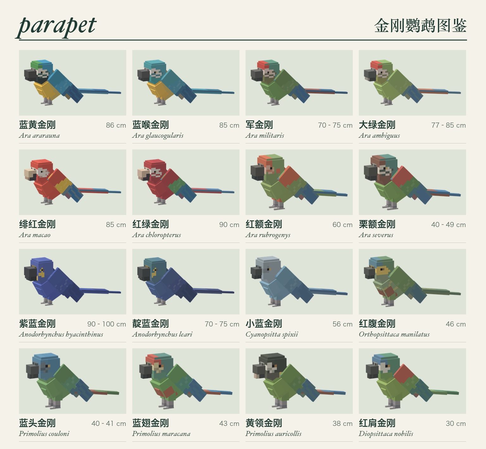

# 金刚鹦鹉图鉴

parapet 收录六个属、16 种有确切活体记录的金刚鹦鹉。每种鸟都有自己的实体和刷怪蛋。下面两条指令分别召唤一只蓝黄金刚、取得一枚蓝喉金刚刷怪蛋。换成表中的实体 ID 即可选择其他物种，刷怪蛋的 ID 在实体名后加 `_spawn_egg`。[世界鹦鹉基金会物种目录](https://parrots.org/parrot-type/macaws/)

```mcfunction
/summon parapet:blue_and_yellow_macaw ~ ~ ~
/give @s parapet:blue_throated_macaw_spawn_egg
```

## 按成鸟外观辨认



体长采用世界鹦鹉基金会的成鸟全长，包括长尾。游戏按各物种的全长设置相对比例。两种鸟即使长度相近，头喙粗细、裸脸范围、翼上的色块也会相当不同。

| 中文名 | 学名 | 成鸟全长 | 外形与羽色 | 实体 ID | 资料 |
| --- | --- | ---: | --- | --- | --- |
| 蓝黄金刚鹦鹉（琉璃金刚） | *Ara ararauna* | 约 86 cm | 背翼天蓝，胸腹金黄。额绿、喉黑，裸脸有细羽线 | `parapet:blue_and_yellow_macaw` | [WPT](https://parrots.org/encyclopedia/blue-and-yellow-macaw/) |
| 蓝喉金刚鹦鹉 | *Ara glaucogularis* | 约 85 cm | 青蓝色从额顶延至背翼，喉部也有一块蓝羽，黄胸上方可见黄颈边 | `parapet:blue_throated_macaw` | [WPT](https://parrots.org/encyclopedia/blue-throated-macaw/) |
| 军金刚鹦鹉（军绿金刚） | *Ara militaris* | 70–75 cm | 通体深绿，红色前额紧邻喙根，蓝色飞羽与天蓝腰羽醒目 | `parapet:military_macaw` | [WPT](https://parrots.org/encyclopedia/military-macaw/) |
| 大绿金刚鹦鹉 | *Ara ambiguus* | 77–85 cm | 身壮、喙粗，身体偏黄绿。额红，脸侧有暗羽线，橙红尾端转蓝 | `parapet:great_green_macaw` | [WPT](https://parrots.org/encyclopedia/great-green-macaw/) |
| 绯红金刚鹦鹉（五彩金刚） | *Ara macao* | 约 85 cm | 长尾、红色头胸。折翼上可依次看见红肩、黄色翼带与蓝色外翼 | `parapet:scarlet_macaw` | [WPT](https://parrots.org/encyclopedia/scarlet-macaw/) |
| 红绿金刚鹦鹉（绿翅金刚） | *Ara chloropterus* | 约 90 cm | 身体深红，中段翼带绿、外翼蓝，白色裸脸上长着明显的红羽线 | `parapet:red_and_green_macaw` | [WPT](https://parrots.org/encyclopedia/red-and-green-macaw/) |
| 红额金刚鹦鹉 | *Ara rubrogenys* | 约 60 cm | 身体橄榄绿，额顶、耳斑、肩部和腿部各有橙红或红羽 | `parapet:red_fronted_macaw` | [WPT](https://parrots.org/encyclopedia/red-fronted-macaw/) |
| 栗额金刚鹦鹉 | *Ara severus* | 40–49 cm | 身形较小，长尾。绿身，额与颏呈栗褐色，翼弯带红，尾端蓝 | `parapet:chestnut_fronted_macaw` | [WPT](https://parrots.org/encyclopedia/chestnut-fronted-macaw/) |
| 紫蓝金刚鹦鹉（风信子金刚） | *Anodorhynchus hyacinthinus* | 90–100 cm | 本图鉴中最长。深钴蓝躯体配厚重黑喙，眼圈、下喙旁的裸皮鲜黄 | `parapet:hyacinth_macaw` | [WPT](https://parrots.org/encyclopedia/hyacinth-macaws/) |
| 靛蓝金刚鹦鹉（李尔氏金刚） | *Anodorhynchus leari* | 70–75 cm | 深蓝偏紫，颈头略带绿调，喙侧有界线鲜明的水滴形淡黄裸皮 | `parapet:lear_macaw` | [WPT](https://parrots.org/encyclopedia/lears-macaw/) |
| 小蓝金刚鹦鹉（斯皮克斯金刚） | *Cyanopsitta spixii* | 约 56 cm | 轮廓纤细，头部灰蓝，身体淡蓝，背与翼逐渐变深，喙黑 | `parapet:spix_macaw` | [WPT](https://parrots.org/encyclopedia/spixs-macaw/) |
| 红腹金刚鹦鹉 | *Orthopsittaca manilatus* | 约 46 cm | 裸脸黄、身体绿，胸前有灰绿鳞状羽缘，腹中部至尾下带暗栗红 | `parapet:red_bellied_macaw` | [WPT](https://parrots.org/encyclopedia/red-bellied-macaw/) |
| 蓝头金刚鹦鹉 | *Primolius couloni* | 40–41 cm | 绿身配蓝色头顶与深蓝灰裸脸。尾基棕红，向尾端过渡为绿 | `parapet:blue_headed_macaw` | [WPT](https://parrots.org/encyclopedia/blue-headed-macaw/) |
| 蓝翅金刚鹦鹉（伊利格氏金刚） | *Primolius maracana* | 约 43 cm | 小型、蓝翼，前额红，冠颈泛蓝，下背和正腹各有红斑，脸皮浅黄 | `parapet:blue_winged_macaw` | [WPT](https://parrots.org/encyclopedia/blue-winged-macaw/) |
| 黄领金刚鹦鹉（金领金刚） | *Primolius auricollis* | 约 38 cm | 后颈有一圈黄领，头顶和颊部暗褐，身体绿，蓝尾基部泛红褐 | `parapet:yellow_collared_macaw` | [WPT](https://parrots.org/encyclopedia/yellow-collared-macaw/) |
| 红肩金刚鹦鹉 | *Diopsittaca nobilis* | 约 30 cm | 本图鉴中最小。黄绿色身羽、蓝额顶、白裸脸，翼弯处一块红色 | `parapet:red_shouldered_macaw` | [WPT](https://parrots.org/encyclopedia/red-shouldered-macaw/) |

## 动作与体型

蓝头、蓝翅、黄领和红肩使用中型动作，其余 12 种使用大型动作。这是游戏对起飞、滑翔与落栖节奏的分配。红腹与蓝翅的成鸟全长仅相差约 3 cm，两者仍各自按表中的长度显示。

## 名录边界

- **斯皮克斯金刚有已知活体。** IUCN 将其列为野外灭绝（EW）。巴西的保育计划有人工繁育和重引入记录，2026 年巴西环境部与圣保罗动物园还公布了一只在园内孵化的雏鸟。图鉴将它作为独立物种收录。[IUCN 物种评估](https://doi.org/10.2305/IUCN.UK.2019-3.RLTS.T22685533A153022606.en) · [巴西官方保育计划](https://www.gov.br/icmbio/pt-br/assuntos/biodiversidade/pan/pan-ararinha-azul/pan-ararinha-azul/) · [圣保罗动物园孵化公告](https://www.gov.br/mma/pt-br/noticias/mma-icmbio-e-zoologico-de-sao-paulo-anunciam-marco-historico-na-conservacao-da-ararinha-azul)
- **灰蓝金刚鹦鹉**（*Anodorhynchus glaucus*）的物种身份明确，是否仍有活体尚缺可靠证据。IUCN 将其列为“极危，可能灭绝”。本版保留这项状态说明，可召唤名录收录上述 16 种。[IUCN 灰蓝金刚评估](https://doi.org/10.2305/IUCN.UK.2019-3.RLTS.T22685527A154380861.en) · [世界鹦鹉基金会野外调查](https://parrots.org/projects/glaucous-macaw-search/)
- **圈养杂交名**描述亲本组合。例如 Catalina 源于蓝黄金刚与绯红金刚，Harlequin 源于蓝黄金刚与红绿金刚。两者的亲本均已列入表中，统计物种时分别按亲本学名计算。[Forest Park 动物园的 Catalina 个体](https://www.forestparkzoo.org/animals/catalina-macaw?dm_device=desktop) · [Arignar Anna 动物园 Harlequin 登记](https://cza.nic.in/uploads/documents/reports/english/AR_arignarannazoo_2021.pdf)
