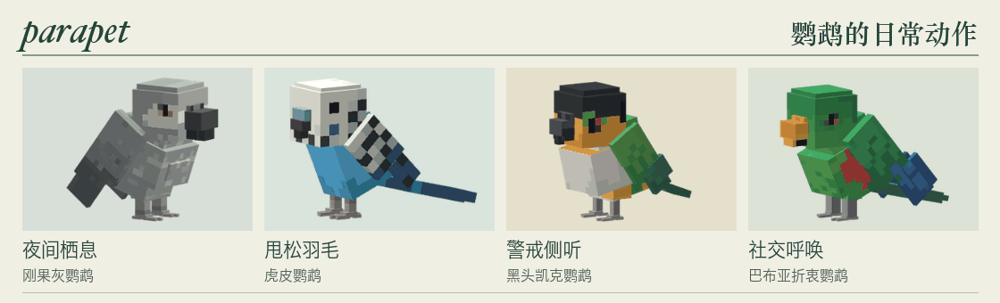

# 从晨鸣到夜栖

## 清晨听同伴回话

在主世界找一处有自然天光的地方，观察 12 格内相互可见的同类野鸟。鸣叫的鸟会伸颈点头，另一只在稍后转头倾听，有时也会轻声回答。附近一群鸟共享一段安静时间。正在受惊、觅食或忙于和玩家互动的鸟会错过这声招呼。

## 白天看它们选食

- **虎皮鹦鹉**落地后，会在附近的矮草或高草旁低头啄籽。这一设计参考了野生虎皮取食草籽的习性。[澳大利亚博物馆的虎皮鹦鹉资料](https://australian.museum/learn/animals/birds/budgerigar/)
- **彩虹吸蜜、红吸蜜和暗色吸蜜鹦鹉**会凑近小花探舌，取食结束时花边偶尔可见花蜜粒子。彩虹吸蜜鹦鹉在现实中会从花朵获取花蜜和花粉。[澳大利亚博物馆的彩虹吸蜜鹦鹉资料](https://australian.museum/learn/animals/birds/rainbow-lorikeet/)

野鸟在植物旁的动作会保留草丛和花朵，不产生物品、亲密度或繁殖进度。想驯服，仍要手持适合该鸟的食物，站定等它靠近。

## 雨后与入夜

持续淋雨、入水或在洗澡池拍水会打湿羽毛。鸟到干处、落稳并空闲后会抖动翅尾，甩出几滴水。已经入住笼子的鸟也能在自己的栖木上甩羽、理羽和侧头。

正常昼夜循环中，从 12500 刻到次日 23000 刻前是夜栖时段。健康的野鸟会尝试飞到附近空旷的树叶或原木上。脚踩稳后，鸟把头贴向肩侧，收起一只脚。天亮、栖点消失或附近出现危险都会打断休息。笼养或听令停留的宠物能在原处休息。跟随中的宠物继续跟随主人。

四组动作分别按小、中、大体型制作，夜栖保持时仍有轻微呼吸。图鉴中的「习性」按钮与 H 键可以查看当前物种的观察提示。

