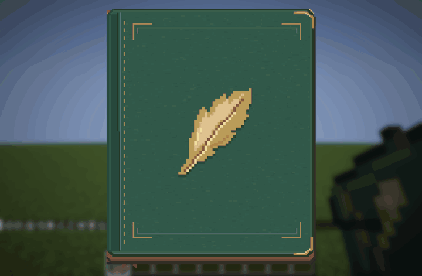

# 使用鹦鹉图鉴

将一本原版书、一根羽毛和一份小麦种子放在任意合成格，顺序不限，即可得到一本鹦鹉图鉴。拿在手中，对空处右键打开。创造模式下，图鉴位于「Parapet 鹦鹉」标签页的第一格。

## 怎样收录

38 个鸟类实体各占一条记录。首次驯服该种鸟就会收录，普通羽色、稀有羽色和雌雄外观共用同一个物种条目。已经归你所有的鸟也能补录，包括跟随、停留和笼内栖息的宠物。旧存档升级后，走近已有的宠物，或将原来装着自家鸟的笼子带在身上再打开图鉴。

进度保存在玩家身上。同一位玩家用不同的图鉴都能接着读，死亡或把鸟卖给商人也会保留记录。不同玩家各自收集。用商人种蛋刚孵化的鸟是野生幼鸟，驯服后即可收入图鉴。

## 阅读页面

第一次展开书页时能看到书封绕书脊转开。单击、空格或回车可以跳过当次开书动画，Esc 可以直接合书。下次重新拿出图鉴还会再播放。

左页写有物种、游戏稀有档、目标群量和原版生物群系，下方的物品图标表示该鸟偏好的驯服材料。把鼠标移到稀有档上，可看到区域出现条件和相对生成权重。每次遇到的实际只数还受落脚空间与原版被动生物数量上限影响。[按物种查阅生态参数](parrot-habitats.md)

右页展示游戏内的立体模型。鸟像上下留有空间，页眉标出模型采用的成鸟参考体长，鼠标移到数值上可查看体型及测量口径。每页独立构图，标出的厘米数可用来比较不同物种。未收录时，保留喙、冠羽和尾羽构成的黑色剪影；收录后显示彩色羽毛。如果该物种有多种外观，点击模型下方的小箭头可以轮换。羽色图版可以帮助对照野外个体和繁殖出的幼鸟。[羽色遗传指南](plumage-inheritance.md)

| 操作 | 鼠标或键盘 |
| --- | --- |
| 翻到前后物种 | 点击页脚箭头，或按左右方向键、Page Up、Page Down |
| 查看当前鸟种的习性 | 点击左页上方「习性」，或按 H。再次按 H 或按 Esc 返回栖地页，翻页可继续查看下一种鸟 |
| 打开目录 | 点击「目录」，或按 I、Home |
| 切换目录筛选 | 在目录点击「全部」或「待收录」，或按 F。只看待收录时仍可直接跳到对应的物种页 |
| 从目录跳转 | 点击物种名，或用上下键选中后按回车 |
| 切换已收录物种的羽色 | 点击模型下方箭头，或在正文按上下键 |
| 合上图鉴 | 点击右上角的关闭按钮，或在正文按 Esc |

翻页时纸叶沿书脊卷起，并播放原版翻书声。
